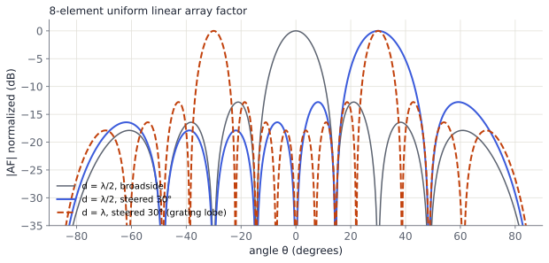

# Beginner · the idea

## The stadium wave {#stadium}



In a stadium wave, each person stands up a moment after the neighbour. The wave moves in one direction because of that small, regular delay.

- An antenna array does the same with radio waves: each element sends the same signal with a slightly shifted **phase**.
- The waves add up in one chosen direction and cancel in others.
- Change the phase steps, and the beam moves: no moving parts.

::: {.box}
[The one idea of this section]{.box-title}
Direction is set by the phase step between elements. Beam width is set by the size of the array.
:::

## Phase per element: a worked example {#phase-example}

Elements half a wavelength apart (d = λ/2) need a phase step of $\Delta\varphi=180^\circ\cdot\sin\theta$. To steer 30°: $\sin 30^\circ=0.5$ → 90° per element.

::: {.compact}
| Element | 1 | 2 | 3 | 4 | 5 | 6 | 7 | 8 |
|---|---|---|---|---|---|---|---|---|
| Phase | 0° | 90° | 180° | 270° | 0° | 90° | 180° | 270° |
:::

::: {.compact}
| Architecture | How | Typical use |
|---|---|---|
| Analog | phase shifters at RF, one beam per panel | FR2 (cheap, low power) |
| Digital | one chain per element, many beams at once | FR1 massive MIMO |
| Hybrid | digital across sub-arrays, analog inside | the middle ground |
:::

# Intermediate · how it works

## Array factor, beamwidth and grating lobes {#af}

Uniform linear array, $N$ elements, spacing $d$, steered to $\theta_0$:

$$
AF(\theta)=\frac{1}{N}\left|\sum_{n=0}^{N-1}e^{\,j2\pi n\frac{d}{\lambda}(\sin\theta-\sin\theta_0)}\right|
$$

::: {.columns}

::: {.column}

::: {.small}

- HPBW ≈ $0.886\,\lambda/(Nd\cos\theta_0)$ rad → ≈ $101.5^\circ/N$ at broadside for $d=\lambda/2$ (12.7° for N = 8).
- Beam broadens by $1/\cos\theta_0$ when steered.
- No grating lobe for scan angles up to $\theta_{\max}$ if $d/\lambda<1/(1+|\sin\theta_{\max}|)$.

:::

:::

::: {.column}

{width="100%"}

:::

:::

::: {.notes}
With d = λ and θ0 = 30°, a grating lobe appears at sin θ = sin 30° − 1 = −0.5 → θ = −30°, as in the figure. Vertical element spacing in many AAUs is larger than λ/2 because each 'element' is a sub-array of 2–3 radiators: vertical steering range is then deliberately limited to a few degrees to avoid grating lobes.
:::

# Advanced · expert depth

## Beamwidth and grating lobes in numbers {#bw-numbers}

$$
\text{HPBW}\approx\frac{0.886\,\lambda}{N d\cos\theta_0}\ \text{rad}\qquad\text{no grating lobe if}\quad \frac{d}{\lambda}<\frac{1}{1+|\sin\theta_{\max}|}
$$

::: {.compact}
| N (d = λ/2) | Broadside HPBW | Steered to 45° |
|---|---|---|
| 4 | 25.4° | 35.9° |
| 8 | 12.7° | 17.9° |
| 16 | 6.3° | 9.0° |
:::

- Scan range ±60° needs $d<0.536\lambda$; ±45° needs $d<0.586\lambda$.
- Vertical spacing in AAUs is often larger (sub-arrays), so vertical steering is deliberately limited to a few degrees.

::: {.notes}
HPBW values: 101.5°/N at broadside, divided by cos θ0 when steered (cos 45° = 0.707). Grating-lobe limits: 1/(1 + sin 60°) = 0.536; 1/(1 + sin 45°) = 0.586.
:::

# Practice

## Exercises {#ex}

1. What phase step steers a λ/2 array to 20°?
2. An 8 × 1 array with d = 0.6λ must scan ±45°. Is there a grating lobe?
3. Why is FR2 usually analog beamforming and FR1 massive MIMO digital?

::: {.aside-note}
Answers in the speaker notes.
:::

::: {.notes}
1. 180° × sin 20° = 61.6° per element.
2. Limit 0.586λ; 0.6λ is just above: a grating lobe starts entering at the scan edge. Use 0.5λ.
3. FR2 needs hundreds of elements over very wide bandwidth: a digital chain per element would cost too much power. FR1 arrays have tens of chains over narrower bandwidth, so full digital (MU-MIMO) is affordable.
:::

## References {#refs}

::: {.refs}
- **3GPP** TS 38.104 §9 (radiated requirements)
- **3GPP** TS 38.214 §5.2.2.2 (codebooks)
- [ShareTechnote · CSI-RS codebook](https://mail.sharetechnote.com/html/5G/5G_CSI_RS_Codebook.html){target="_blank"}
- [ShareTechnote · Beam management](https://www.sharetechnote.com/html/5G/5G_Phy_BeamManagement.html){target="_blank"}
- C. Johnson, *5G New Radio in Bullets*, independently published, 2019 (ISBN 978-1077484351)
- E. Dahlman, S. Parkvall, J. Sköld, *5G NR: The Next Generation Wireless Access Technology*, 2nd ed., Academic Press, 2020
:::
