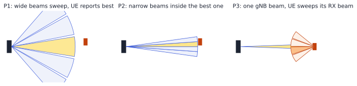
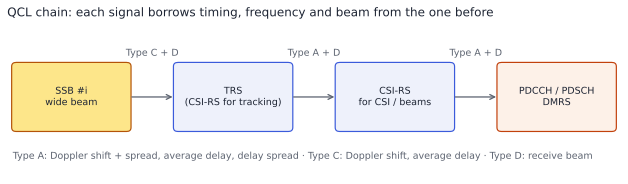
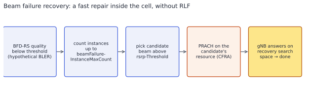

# Beginner · the idea

## Find, refine, track {#find-refine}



Talking with a narrow beam is like using a torch in the dark: you must point it at the person and follow them as they move.

- **Find (P1)**: the cell sweeps wide beams (the SSBs). The phone picks the best.
- **Refine (P2)**: the cell tries narrower beams around that one. The phone says which is best.
- **Track (P3)**: the phone fine-tunes its own receive beam.
- If the beam is lost (a hand, a bus), **beam failure recovery** quickly finds a new one.

::: {.box}
[The one idea of this section]{.box-title}
At mmWave, keeping the beam aligned is as important as staying on the right cell.
:::

## P1, P2, P3 in pictures {#p123-pic}

{width="98%"}

- **P1**: wide beams (often the SSBs) find the right direction.
- **P2**: narrow CSI-RS beams inside it find the best fine beam.
- **P3**: the gNB repeats one beam so the UE can choose its own receive beam.

# Intermediate · how it works

## P1, P2, P3 and how they are really configured {#p123}

::: {.compact}
| Procedure | Who sweeps | Reference signal | Configuration |
|---|---|---|---|
| P1 · initial selection | gNB wide beams | SSB (or CSI-RS) | SSB burst + RACH occasion mapping, L1-RSRP report |
| P2 · gNB TX refinement | gNB narrow beams | CSI-RS | resource set with `repetition off`, report CRI + L1-RSRP |
| P3 · UE RX refinement | UE RX beams | CSI-RS | resource set with `repetition on`, no report needed |
:::

::: {.small}

The specifications never use the names P1–P3: what is configured is a CSI-RS resource set and its `repetition` flag. With repetition off, the UE cannot assume the resources share a TX beam (the gNB is sweeping). With repetition on, they do (the UE sweeps).

:::

::: {.spec}

TS 38.214 §5.1.6.1.2, §5.2.1.4 · TS 38.331 NZP-CSI-RS-ResourceSet

:::

::: {.notes}
This point is made directly on ShareTechnote's beam management page: P1/P2/P3 are industry names kept from the study item. Up to 4 beams per L1-RSRP report in Rel-15 (nrofReportedRS), with the best in 7 bits absolute and others as 4-bit differentials in 2 dB steps.
:::

## CSI-RS and what the UE reports {#csi-rs}

- CSI-RS ports: 1, 2, 4, 8, 12, 16, 24, 32. One port is used for TRS (tracking). Multi-port for CSI acquisition and beam management.
- Configured, not always on (unlike LTE CRS), and designed for beamforming: each resource can carry its own beam.
- Report quantities: CRI (which resource/beam), RI, PMI, CQI, LI, L1-RSRP, L1-SINR (Rel-16).
- Periodic (PUCCH), semi-persistent (PUCCH/PUSCH), aperiodic (PUSCH, triggered by DCI).

::: {.box}

[Hierarchy]{.box-title}CSI-ResourceConfig → resource sets → NZP-CSI-RS resources (ports, density, period, QCL source); CSI-ReportConfig → what to report, from which resources, on which channel.

:::

::: {.spec}

TS 38.211 §7.4.1.5 · TS 38.214 §5.2 · TS 38.331 CSI-MeasConfig

:::

::: {.notes}
ShareTechnote's CSI framework page explains how these RRC objects point at each other, and why one framework covers beam management, tracking loops and closed-loop MIMO. Start any CSI troubleshooting from the report configuration: a UE reporting CQI on the wrong resource set is a configuration problem, not a radio one.
:::

## How the specification really does it {#p123-spec}

- The names P1/P2/P3 come from the study phase (TR 38.802); the TS only knows **CSI-RS resource sets** with `repetition`:
  - `repetition off`: each resource may be a different gNB beam → P1/P2, UE reports the best (CRI + L1-RSRP).
  - `repetition on`: all resources use the same gNB beam → P3, the UE refines its RX beam and reports nothing.
- Reports: up to 4 beams per report (`nrofReportedRS`), the strongest absolute (7 bits), the others **differential** (4 bits, 2 dB steps).
- Rel-16 adds **L1-SINR** reporting, which includes interference when choosing beams.

## QCL: borrowing what was measured {#qcl}

{width="96%"}

- A TCI state says "receive this signal **as if** it came like that one", so the UE reuses timing, Doppler and receive beam instead of estimating them again.
- Up to **128** TCI states per BWP for PDSCH (64 per CORESET); a MAC CE activates up to **8**; a **3-bit** DCI field picks one.

# Advanced · expert depth

## Type I single-panel codebook {#type1}

$P_{CSI\text{-}RS}=2N_1N_2$ ports (dual polarization). Precoder $W=W_1W_2$:

$$
v_{l,m}=u_m\otimes\left[1,\ e^{j2\pi l/(O_1N_1)},\ \dots,\ e^{j2\pi l(N_1-1)/(O_1N_1)}\right]^T,\qquad \varphi_n=e^{j\pi n/2}
$$

::: {.small}

- $i_1=(i_{1,1},i_{1,2})$: beam from an oversampled 2D DFT grid of $N_1O_1\times N_2O_2$ directions.
- $i_2$: co-phasing $\varphi_n$ between polarizations (and beam selection for some modes).
- Example: 32 ports, $(N_1,N_2)=(8,2)$, $(O_1,O_2)=(4,4)$ → 32 × 8 = 256 grid beams.
- Type II: linear combination of 2–4 beams with amplitude and phase per sub-band: finer CSI for MU-MIMO, much larger report.

:::

::: {.spec}

TS 38.214 §5.2.2.2.1 (Type I), §5.2.2.2.3 (Type II)

:::

::: {.notes}
The oversampling factors O1, O2 set the angular step of the beam grid (ShareTechnote's codebook page notes they determine the beam sweeping step). With N1 = 8, O1 = 4 the horizontal grid has 32 directions across the visible region; adjacent beams overlap at about −1 dB, so the UE's PMI choice is robust to small movements.
:::

## TCI states, QCL and beam failure recovery {#tci}

::: {.columns}

::: {.column}

**QCL types**

::: {.compact}
|  |  |
|---|---|
| A | Doppler shift, Doppler spread, average delay, delay spread |
| B | Doppler shift, Doppler spread |
| C | Doppler shift, average delay |
| D | spatial RX parameter (the beam) |
:::

::: {.small}

Up to 128 TCI states configured for PDSCH, up to 8 activated by MAC CE, selected by a 3-bit DCI field.

:::

:::

::: {.column}

**Beam failure recovery**

::: {.small}

1. UE monitors BFD-RS: hypothetical PDCCH BLER above Qout (10 %) counts one instance.
2. `beamFailureInstanceMaxCount` reached before the timer expires → beam failure.
3. UE picks a candidate beam with RSRP above `rsrp-ThresholdSSB`.
4. Contention-free PRACH on that beam's preamble; gNB answers in the recovery search space.

:::

:::

:::

::: {.spec}

TS 38.214 §5.1.5 · TS 38.213 §6 · TS 38.321 §5.17 · TS 38.133 §8.5

:::

::: {.notes}
A TCI state says: 'receive this PDSCH as you would receive reference signal X'. Type D tells an FR2 UE which RX beam to use. If a TCI activation MAC CE is lost or late, the UE listens with the wrong beam: throughput collapses while RSRP on the old beam still looks fine. ShareTechnote's QCL page shows RRC examples where PDCCH TCI states point at NZP-CSI-RS resources.
:::

## Beam failure recovery {#bfr}

{width="96%"}

- Detection: the PDCCH beam's reference signals fall below a quality threshold (hypothetical PDCCH BLER) `beamFailureInstanceMaxCount` times before a timer expires.
- Recovery uses a **contention-free PRACH** linked to the new beam, so the gNB learns the beam from the preamble itself. Faster than RLF and re-establishment.

## Type I vs Type II CSI {#type1-type2}

::: {.compact}
| | Type I single-panel | Type II (Rel-15) | eType II (Rel-16) |
|---|---|---|---|
| Idea | pick **one** DFT beam + co-phase | **combine** up to 4 beams with amplitude + phase | combine beams over angle **and delay** |
| Layers | up to 8 | up to 2 | up to 4 |
| Feedback | tens of bits | hundreds of bits | compressed (frequency-domain DFT) |
| Use | SU-MIMO, FDD/TDD | MU-MIMO in FDD | MU-MIMO with less overhead |
:::

- Ports = 2·N1·N2 (two polarisations), oversampling O1 = 4 (O2 = 4 if N2 > 1): a 32-port panel (N1 = 8, N2 = 2) has 32 × 8 = 256 candidate beams for Type I.
- Rel-18/19 add **Doppler-domain** CSI for moving users and coherent joint transmission (CJT) from several TRPs.

::: {.notes}
Summarized from ShareTechnote's CSI-RS codebook and Release 19 pages. Type II's amplitude reporting is what makes MU-MIMO pairing possible in FDD, where SRS reciprocity is not available.
:::

# Practice

## Exercises {#ex}

1. A CSI-RS resource set has `repetition on`. Who is sweeping beams, and does the UE report anything?
2. How many grid beams does a Type I codebook offer with (N~1~, N~2~) = (8, 2) and (O~1~, O~2~) = (4, 4)?
3. A UE reports good L1-RSRP on beam 5 but PDSCH BLER is high. Name two beam-management causes and how to confirm them.

::: {.aside-note}
Answers in the speaker notes.
:::

::: {.notes}
1. The gNB repeats one TX beam; the UE sweeps its RX beams (P3). No report is needed.
2. N1O1 × N2O2 = 32 × 8 = 256 beams.
3. Stale or wrong TCI state (lost/late MAC CE activation): check TCI activation MAC CE and the DCI TCI field. No UE RX refinement configured: check NZP-CSI-RS-ResourceSet repetition. Frequent beam failure: check BFR counters and beamFailureInstanceMaxCount.
:::

## References {#refs}

::: {.refs}
- **3GPP** TS 38.214 §5.1.5 (TCI/QCL), §5.2 (CSI)
- **3GPP** TS 38.213 §6 (link recovery) · TS 38.321 §5.17
- **3GPP** TS 38.211 §7.4.1.5 (CSI-RS)
- [ShareTechnote · Beam management](https://www.sharetechnote.com/html/5G/5G_Phy_BeamManagement.html){target="_blank"}
- [ShareTechnote · CSI-RS](https://www.sharetechnote.com/html/5G/5G_CSI_RS.html){target="_blank"}
- [ShareTechnote · CSI framework](https://www.sharetechnote.com/html/5G/5G_CSI_Framework.html){target="_blank"}
- [ShareTechnote · QCL / TCI](https://www.sharetechnote.com/html/5G/5G_QCL.html){target="_blank"}
- [ShareTechnote · CSI-RS codebook](https://mail.sharetechnote.com/html/5G/5G_CSI_RS_Codebook.html){target="_blank"}
- [ShareTechnote · CSI-RS codebook](https://www.sharetechnote.com/html/5G/5G_CSI_RS_Codebook.html){target="_blank"}
- [ShareTechnote · Beam failure recovery](https://www.sharetechnote.com/html/5G/5G_BeamFailureRecovery.html){target="_blank"}
- C. Johnson, *5G New Radio in Bullets*, independently published, 2019 (ISBN 978-1077484351)
- E. Dahlman, S. Parkvall, J. Sköld, *5G NR: The Next Generation Wireless Access Technology*, 2nd ed., Academic Press, 2020
:::
