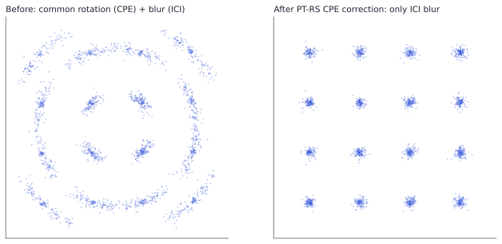
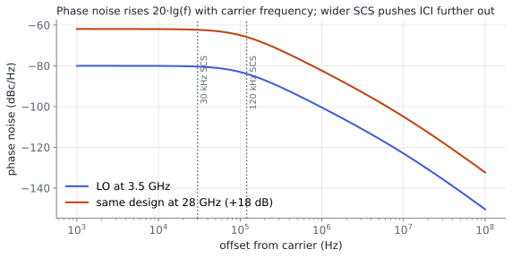

# Beginner · the idea

## A shaky clock {#shaky-clock}



Every radio builds its carrier from a reference oscillator, a very precise clock. No clock is perfect: its phase wobbles a little. That wobble is **phase noise**.

- To reach 28 GHz, the radio multiplies its reference many times. The wobble is multiplied too.
- From the same reference, 28 GHz has **8× the frequency and 18 dB more phase noise** than 3.5 GHz.
- Phase noise blurs the constellation points, so high-order modulation (256QAM) fails first.

::: {.box}
[The one idea of this section]{.box-title}
Phase noise is why FR2 uses wide subcarrier spacing (120 kHz) and a dedicated tracking signal (PT-RS).
:::

## Two effects, two cures {#two-effects}

::: {.compact}
| Effect | What it does | Cure |
|---|---|---|
| Common phase error (CPE) | rotates every subcarrier of a symbol by the same angle | measure it with PT-RS and remove it |
| Inter-carrier interference (ICI) | leaks energy between subcarriers, acts like noise | wider subcarrier spacing, a cleaner oscillator |
:::

::: {.kpis}
::: {.kpi}
[+20·lg N]{.kpi-val}[phase noise after ×N multiplication]{.kpi-label}
:::
::: {.kpi}
[EVM ≈ σ~φ~]{.kpi-val}[RMS phase error in radians]{.kpi-label}
:::
::: {.kpi}
[≈ 2°]{.kpi-val}[max RMS phase error for 256QAM]{.kpi-label}
:::
:::

## What phase noise does to a constellation {#pn-const}

{width="86%"}

- Left: every point turns by the same angle (CPE) and is also blurred (ICI).
- Right: after measuring and undoing the common rotation with PT-RS, only the blur is left.

# Intermediate · how it works

## Phase noise: CPE and ICI {#pn-model}

Received subcarrier $k$ of symbol $l$ with oscillator phase $\phi(t)$:

$$
Y_{k}=X_k H_k\,\underbrace{J_0}_{\text{CPE}}+\underbrace{\sum_{m\ne k}X_m H_m J_{m-k}}_{\text{ICI}},\qquad J_n=\frac{1}{T_u}\int_0^{T_u}e^{j\phi(t)}e^{-j2\pi n t/T_u}\,dt
$$

- **CPE**: the same rotation on every subcarrier of a symbol. Estimate it from pilots and remove it.
- **ICI**: phase-noise power at offsets ≳ Δf leaks between subcarriers and acts as noise. Only a wider Δf (or a cleaner oscillator) reduces it.
- Multiplying a reference by N raises phase noise by $20\lg N$: 3.5 → 28 GHz from the same reference is +18 dB.

::: {.box}

[EVM rule of thumb]{.box-title}Residual RMS phase error $\sigma_\phi$ (rad) gives $\text{EVM}\approx\sigma_\phi$. 256QAM's 3.5 % limit allows about 2° RMS after CPE removal.

:::

::: {.notes}
Derive J0 as the average of e^{jφ} over the symbol: low-frequency phase noise (inside the subcarrier spacing) is common to all subcarriers, hence CPE. High-frequency phase noise produces J_n ≠ 0 for n ≠ 0, i.e. ICI. Doubling SCS halves T_u, which moves more of the phase-noise spectrum into the 'common' part. This is the physics behind 120 kHz in FR2, not latency.
:::

## Why it is worse at 28 GHz {#pn-freq}

{width="84%"}

- Multiplying a reference up to the carrier multiplies its phase noise: **+20·lg(f₂/f₁)**. From 3.5 to 28 GHz: **+18 dB**.
- Phase noise at offsets **below** the subcarrier spacing mostly turns into CPE (correctable); noise **above** it turns into ICI (not correctable). Wider SCS (120 kHz) pushes more noise into the correctable part.

# Advanced · expert depth

## PT-RS: tracking CPE in NR {#ptrs}

::: {.columns}

::: {.column}

- Present on PDSCH and PUSCH only, when configured.
- Time density $L_{PT\text{-}RS}\in\{1,2,4\}$ symbols, frequency density $K_{PT\text{-}RS}\in\{2,4\}$ RBs.
- Density follows scheduled MCS and bandwidth through RRC thresholds (`timeDensity`, `frequencyDensity`).
- Mapped on one subcarrier of a DMRS port: overhead is under 1 % at the densest setting with wide allocations.

:::

::: {.column}

::: {.compact}
| Scheduled MCS | Time density |
|---|---|
| < ptrs-MCS1 | no PT-RS |
| ptrs-MCS1 … ptrs-MCS2 | every 4th symbol |
| ptrs-MCS2 … ptrs-MCS3 | every 2nd symbol |
| ≥ ptrs-MCS3 | every symbol |
:::

::: {.spec}

TS 38.214 Table 5.1.6.3-1 · TS 38.211 §7.4.1.2

:::

:::

:::

::: {.box .field}

[Field symptom]{.box-title}High-MCS BLER in FR2 that improves when PT-RS density is increased, with no change in SINR, points to phase noise in the UE or gNB LO chain.

:::

::: {.notes}
ShareTechnote's DL resource grid simulator lets you toggle PT-RS densities and see the RE pattern. In FR1 PT-RS is usually disabled: phase noise at 3.5 GHz with 30 kHz SCS rarely limits 256QAM. In FR2 it is effectively mandatory for 64QAM and above.
:::

## PT-RS configuration {#ptrs-config}

- **Time density** $L_{PT\text{-}RS}$ ∈ {1, 2, 4} symbols, from the scheduled MCS against `ptrs-MCS1…3`. Below ptrs-MCS1: no PT-RS (low-order modulation tolerates CPE).
- **Frequency density** $K_{PT\text{-}RS}$ ∈ {2, 4} RBs, from the scheduled bandwidth (default 2).
- Each PT-RS port is tied to one DMRS port; an RNTI-based offset keeps different UEs' PT-RS on different subcarriers.
- Dense in time, sparse in frequency: the **opposite** of DMRS, because phase noise changes fast but is the same over the whole carrier.

::: {.box .field}
[Trade-off]{.box-title}
L = 1, K = 2 costs about 3.6 % of the PDSCH REs (half an RE per RB in about 12 symbols), K = 4 about 1.8 %. Leave PT-RS on in FR2 at 64QAM and above; switching it off to gain REs usually loses more through EVM.
:::

::: {.notes}
From ShareTechnote's DL PT-RS page: PT-RS is absent below ptrs-MCS1; L defaults to 1 and K to 2 when not configured; epre-Ratio sets PT-RS power relative to PDSCH.
:::

# Practice

## Exercises {#ex}

1. An LO has −90 dBc/Hz at 100 kHz offset at 3.5 GHz. Estimate its level at 39 GHz from the same reference.
2. Residual RMS phase error is 1.5°. What EVM does that alone cause? Does it fit 256QAM's 3.5 %?
3. Why does doubling the subcarrier spacing reduce phase-noise ICI?

::: {.aside-note}
Answers in the speaker notes.
:::

::: {.notes}
1. 20·lg(39/3.5) = +20.9 dB → about −69 dBc/Hz.
2. 1.5° = 0.0262 rad → EVM ≈ 2.6 %: fits 256QAM alone, but leaves little room for PA and filter EVM.
3. The symbol becomes half as long, so more of the phase-noise spectrum lies within the subcarrier spacing and appears as common phase error, which PT-RS removes, instead of ICI.
:::

## References {#refs}

::: {.refs}
- **3GPP** TS 38.211 §7.4.1.2 (PT-RS)
- **3GPP** TS 38.214 §5.1.6.3 (PT-RS density)
- [ShareTechnote · Reference signals (incl. PT-RS)](https://www.sharetechnote.com/html/5G/5G_Phy_ReferenceSignal.html){target="_blank"}
- [ShareTechnote · DL resource grid simulator](http://sharetechnote.com/html/WebProgramming/Websim_ResourceGridDl5G.html){target="_blank"}
- [ShareTechnote · PT-RS (downlink)](https://www.sharetechnote.com/html/5G/5G_PTRS_DL.html){target="_blank"}
- [ShareTechnote · UE mmWave](https://www.sharetechnote.com/html/5G/5G_UE_mmWave.html){target="_blank"}
- [ShareTechnote · Numerology](https://www.sharetechnote.com/html/5G/5G_FrameStructure.html){target="_blank"}
- C. Johnson, *5G New Radio in Bullets*, independently published, 2019 (ISBN 978-1077484351)
- E. Dahlman, S. Parkvall, J. Sköld, *5G NR: The Next Generation Wireless Access Technology*, 2nd ed., Academic Press, 2020
:::
